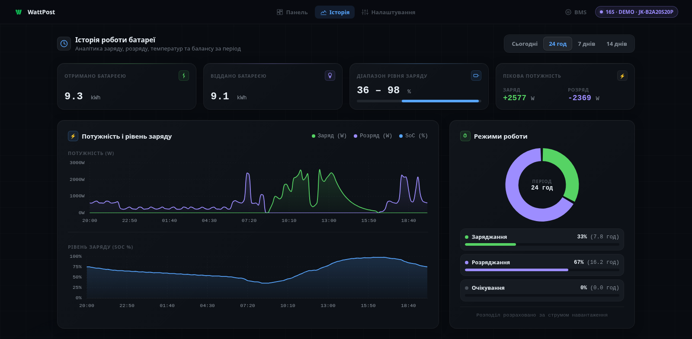
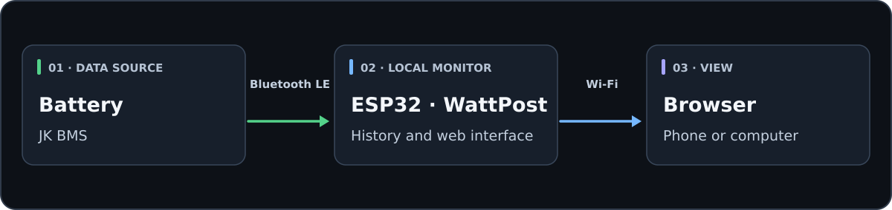

# WattPost

[Українська](README.md) · **English**

WattPost is ESP32 firmware that reads battery telemetry from a JK BMS over Bluetooth LE and displays it in a browser. The ESP32 sits near the battery; your phone or computer accesses its status over your home Wi-Fi network.

Local monitoring and history work without an account or internet connection. Optional WattPost Cloud access lets you check the battery away from home.

[Installation](docs/INSTALLATION.en.md) · [Interface gallery](docs/INTERFACE.en.md) · [Firmware download](https://github.com/DJZeuS21/WattPost-ESP32/releases) · [Build from source](esp32_monitor/README.md)

*Dashboard during discharge. Select the image to see the full panel, including charts and voltages for all 16 cells.*

**All demonstration screens use synthetic data**, not measurements from a real device. The example battery is a 16S LiFePO4 pack rated at 280 Ah. The device name includes `DEMO`.

## What You Can See

- **Live status:** charging, discharging or idle, state of charge, voltage, current, power and remaining capacity.
- **Cells and temperatures:** individual cell voltages, minimum, maximum, voltage spread and available temperature sensors.
- **Up to 14 days of history:** 10-minute averaged records stored in ESP32 Flash and retained across reboots. Daily energy totals, zoomable charts and an hourly load profile.
- **BMS settings:** read-only inspection of protection thresholds, balancing, current limits and temperature limits. This screen does not change BMS parameters.
- **Phone access:** the same interface adapts to smaller screens; no separate app is needed.

### A Day in History

*A complete day: overnight base load, morning demand peaks, variable daytime charging and evening discharge. State of charge is calculated from current rather than drawn as an independent curve. This is a simulated scenario, not an operating log.*

[Full gallery: weekly history, temperatures, BMS Settings and mobile views →](docs/INTERFACE.en.md)

## What You Need

- **Classic ESP32 with 4 MB Flash:** for example, an ESP32-WROOM-32 / ESP32-WROOM-32D DevKit with USB. You also need a USB data cable and a standard 5 V USB power supply. This build does not target ESP32-C3 or ESP32-S3 boards.
- **Battery with a compatible JK BMS and Bluetooth LE.** Bluetooth alone does not guarantee compatibility; the model and protocol matter. The screenshots are illustrative and do not constitute a list of tested models.
- **2.4 GHz Wi-Fi** and a computer for the initial USB installation.

No wired connection to the BMS is needed to read telemetry. Release the BMS Bluetooth connection before connecting the ESP32: the JK phone app may be keeping it occupied.

> [!WARNING]
> WattPost provides monitoring and does not replace JK BMS protection. Never connect ESP32 pins directly to the battery power terminals.

## Installation and First Start

1. Download **`WattPost-ESP32-full.bin`** from [Releases](https://github.com/DJZeuS21/WattPost-ESP32/releases).
2. Write the full image over USB at address **`0x0`**, following the [step-by-step guide](docs/INSTALLATION.en.md). You do not need to build the source code.
3. Join **`WattPost-XXXX`** Wi-Fi with password **`12345678`** and open **http://192.168.4.1/**. Select your home network and JK BMS in the setup wizard; you can add the BMS later.
4. Rejoin your home Wi-Fi and open **http://bms.local/** or the ESP32 IP address.

If the device cannot be found or readings are missing, see [troubleshooting](docs/INSTALLATION.en.md#8-troubleshooting).

## How It Works

<picture>
  <source media="(max-width: 640px)" srcset="docs/diagrams/how-it-works-en-mobile.svg">
  
</picture>

1. **JK BMS** continuously monitors battery cells and provides telemetry to a connected device over Bluetooth Low Energy (BLE).
2. **ESP32** running WattPost firmware connects wirelessly to the BMS, parses telemetry frames, and records local history. ESP32 does not need a wired connection to the battery terminals to read BMS telemetry.
3. **Local Web Interface** is available from a phone or computer on the same network at `http://bms.local/` (or the ESP32 IP address).

## Local and Cloud Access

| Feature | Local Mode (WattPost Local) | Cloud Access (WattPost Cloud) |
|:---:|:---:|:---:|
| **Access URL** | `http://bms.local/` or local IP | [wattpost.pp.ua](https://wattpost.pp.ua) |
| **Account / Sign-up** | **Not required** | Free account |
| **Internet Connection**| **Not required** (works offline) | Required for remote viewing |
| **Privacy** | Telemetry stays local unless you enable Cloud sync | Sent to WattPost Cloud |
| **Remote Access** | Local Wi-Fi network only | Anywhere in the world over the internet |
| **Multiple Batteries** | Accessed per ESP32 device | Multiple ESP32 devices in one account |
| **Firmware Updates** | Via connected WattPost Cloud | Automatic or manual signed OTA updates |

> [!NOTE]
> The local web interface is fully functional and completely autonomous. Connecting to WattPost Cloud is **entirely optional**. If the Cloud or internet connection is unavailable, the ESP32 continues reading BMS metrics and recording history locally.

## Firmware Updates

After the first USB installation, official updates can be installed through WattPost Cloud when the ESP32 has internet access. The device checks the signature before installation; two firmware partitions allow it to return to the previous version if the new one fails startup validation.

## Source Code & Local Build

The firmware and local web interface source code are located in [`esp32_monitor/`](esp32_monitor/).
- Built using the official **ESP-IDF 5.5.5** toolchain.
- Build instructions are available in [`esp32_monitor/README.md`](esp32_monitor/README.md).
- The WattPost Cloud backend is a proprietary service and is not part of this repository.
- Verification checksums and build provenance for the official release binary are documented in [Release Provenance](docs/RELEASE_PROVENANCE.md).

## License & Permitted Use

WattPost is distributed under the **[Apache 2.0 with Commons Clause](LICENSE)** license.

This is a **source-available** license, not OSI-defined Open Source:
- **Free for Personal and Internal Business Use**: You are free to use WattPost at home, in an office, shop, or within any business to monitor your own batteries; study and modify the source code; and share it free of charge.
- **Selling WattPost is Prohibited**: You may not resell the firmware, sell WattPost as a paid product or service, or sell pre-flashed commercial hardware based on WattPost without a separate commercial agreement from the rightsholder.

Third-party libraries and components retain their respective original licenses (see [THIRD_PARTY_NOTICES.md](THIRD_PARTY_NOTICES.md)).
