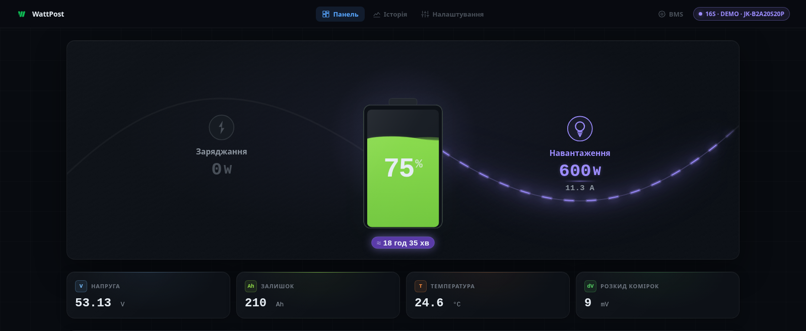
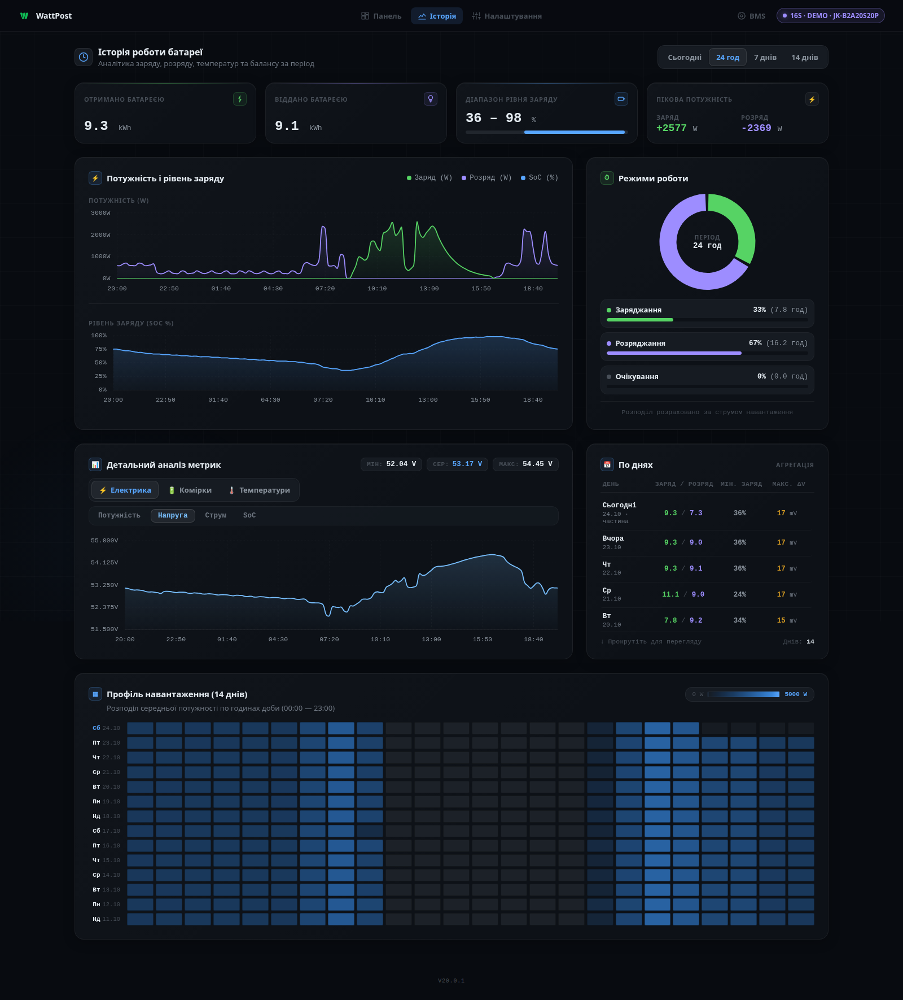
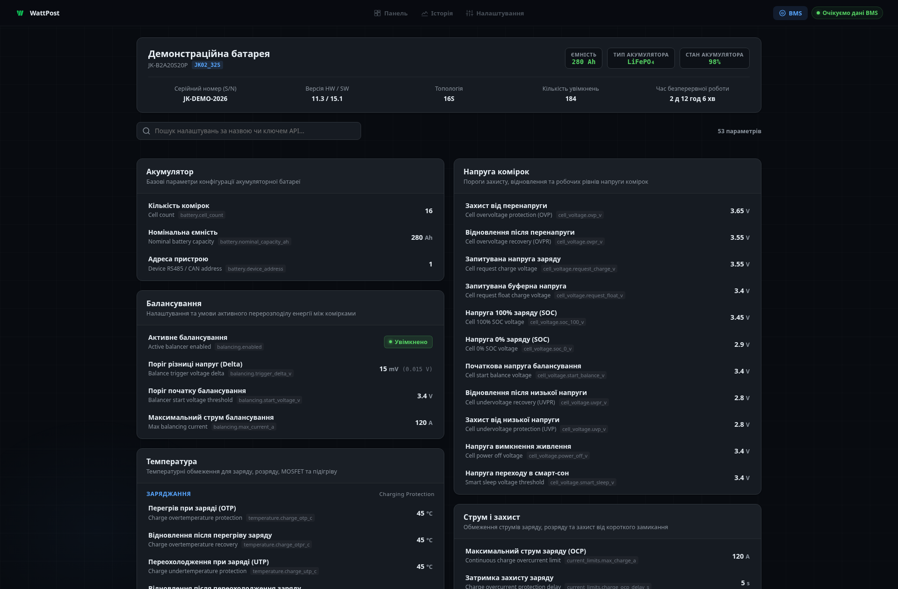
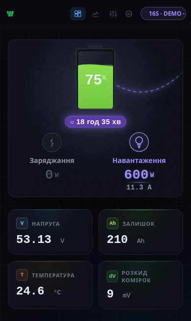
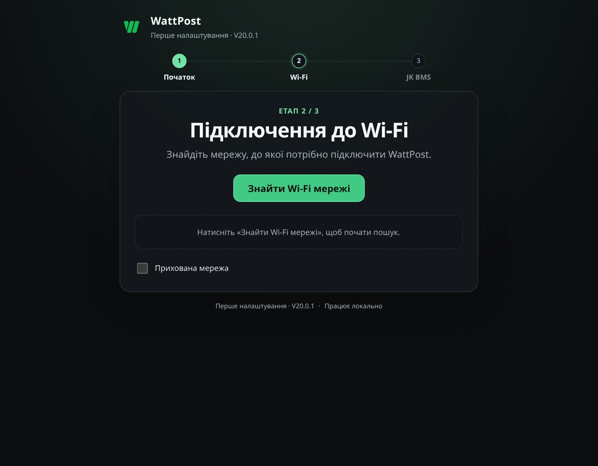

# WattPost

**Українська** · [English](README.en.md)

**WattPost** — це прошивка для мікроконтролера ESP32, яка бездротово зчитує показники акумулятора з **JK BMS** через Bluetooth Low Energy (BLE) та відображає їх у сучасному вебінтерфейсі прямо у вашому браузері.

Проєкт створено для власників домашніх сонячних електростанцій, систем резервного живлення (ДБЖ / UPS) та саморобних акумуляторних збірок (LiFePO4, NMC, LTO). Вам більше не потрібно перебувати поруч із батареєю з відкритим мобільним додатком JK BMS — стан живлення доступний із будь-якого смартфона, планшета чи комп’ютера у вашій локальній мережі.

---

## Інтерфейс WattPost


*Головний екран моніторингу WattPost (Dashboard). Зображення створене на базі реального вебінтерфейсу з демонстраційними даними 16S LiFePO4.*

---

## Основні можливості

- **Панель моніторингу (Dashboard)**
  Візуалізація потоків енергії в реальному часі (заряд, розряд або очікування), рівень заряду (SOC %), загальна напруга, струм і активна потужність у ватах. Інтерактивні графічні індикатори напруги кожної комірки з автоматичним підсвічуванням найвищої та найнижчої комірок, балансування та дельта (розбіг у мілівольтах).

- **Локальна історія до 14 днів (History)**
  ESP32 накопичує дані у власній Flash-пам’яті без потреби в SD-картах чи сторонніх серверах. Графіки напруги, струму, потужності, температур і розбігу комірок дають змогу детально аналізувати цикли заряду та розряду. Дані зберігаються при перезавантаженні пристрою.

- **Перегляд налаштувань BMS (BMS Settings)**
  Зручне структуроване відображення всіх параметрів, зчитаних із JK BMS: захист за напругою (OVP/UVP), поріг та струм активного балансування, струмові ліміти, температурні відсічки, серійний номер, версії апаратного та програмного забезпечення BMS.

- **Мобільна адаптивність**
  Інтерфейс адаптовано для смартфонів: зручно користуватися як на великому моніторі комп'ютера, так і на екрані смартфона.

---

## Як це працює

```
┌─────────────────┐       Bluetooth LE       ┌─────────────────┐        Wi-Fi (mDNS)        ┌─────────────────┐
│     Акумулятор   │ ──────────────────────> │      ESP32      │ ─────────────────────────> │   Будь-який     │
│    з JK BMS     │   (без дротів,      │ з прошивкою     │    http://bms.local/       │   браузер       │
│                 │    без дротів)          │   WattPost      │   (або IP-адреса)          │  (телефон/ПК)   │
└─────────────────┘                         └─────────────────┘                            └─────────────────┘
```

1. **JK BMS** постійно контролює стан батареї та надає телеметрію підключеному пристрою через Bluetooth Low Energy (BLE).
2. **ESP32** з прошивкою WattPost підключається до BMS по повітрю, обробляє пакети даних і записує історію. Для отримання телеметрії ESP32 не потрібно підключати проводами до силових клем акумулятора.
3. **Локальний вебінтерфейс** транслюється у вашу домашню Wi-Fi-мережу. Ви відкриваєте звичайний браузер і бачите все, що відбувається з акумулятором.

---

## Локальний доступ vs Хмара

| Параметр | Локальний режим (WattPost Local) | Хмарний доступ (WattPost Cloud) |
|---|---|---|
| **Адреса** | `http://bms.local/` або локальна IP | [wattpost.pp.ua](https://wattpost.pp.ua) |
| **Реєстрація** | **Не потрібна** | Потрібен безкоштовний акаунт |
| **Інтернет** | **Не потрібен** (працює автономно) | Потрібен для віддаленого перегляду |
| **Конфіденційність** | Дані залишаються локально, якщо ви не ввімкнули Cloud | Дані синхронізуються із захищеною хмарою |
| **Віддалений доступ** | Лише всередині Wi-Fi мережі | З будь-якої точки світу через інтернет |
| **Кілька пристроїв** | Окремо на кожному пристрої | Моніторинг кількох ESP32 в одному кабінеті |
| **Оновлення (OTA)** | Через підключений WattPost Cloud | Автоматичні або ручні підписані оновлення |

> [!NOTE]
> Локальний вебінтерфейс є повнофункціональним і незалежним. Підключення до WattPost Cloud є **повністю добровільним**. Якщо хмара або інтернет недоступні, ESP32 продовжує зчитувати показники BMS і зберігати історію локально.

---

## Галерея інтерфейсу

<p align="center">
  <b>Історія роботи та графіки (History)</b><br>
  
</p>

<p align="center">
  <b>Перегляд конфігурації JK BMS (BMS Settings)</b><br>
  
</p>

<table align="center">
  <tr>
    <td align="center"><b>Мобільна версія Dashboard</b></td>
    <td align="center"><b>Майстер першого налаштування (Setup)</b></td>
  </tr>
  <tr>
    <td align="center" valign="top">
      
    </td>
    <td align="center" valign="top">
      
    </td>
  </tr>
</table>

*Усі скриншоти зняті в актуальному вебінтерфейсі прошивки V20.0.1 із безпечними демонстраційними даними (DEMO telemetry).*

---

## Що потрібно для запуску

1. **Плата розробника ESP32** — класична ESP32 (ESP32-WROOM-32 / ESP32-WROOM-32D DevKit) з **4 МБ Flash** та роз'ємом USB. Живиться від звичайного 5V USB-адаптера чи блока живлення.
2. **Акумулятор із підтримуваною JK BMS**, що має вбудований Bluetooth LE.
3. **Wi-Fi-мережа 2,4 ГГц** для доступу до вебінтерфейсу.

> [!WARNING]
> WattPost є виключно системою моніторингу та індикації. Він не керує силовими контактами напряму та не замінює захисних функцій самої JK BMS. Не підключайте піни ESP32 безпосередньо до високовольтних клем акумулятора!

---

## Швидке встановлення

Не маєте досвіду роботи з мікроконтролерами? Ознайомтеся з нашою **[покроковою інструкцією для новачків](docs/INSTALLATION.md)**.

1. Завантажте готовий образ **`WattPost-ESP32-full.bin`** зі сторінки [GitHub Releases](https://github.com/DJZeuS21/WattPost-ESP32/releases).
2. Під'єднайте ESP32 до комп'ютера USB-кабелем для передачі даних.
3. Запишіть файл утилітою `esptool` за зміщенням **`0x0`**:
   ```bash
   python -m esptool --chip esp32 --port PORT --baud 460800 write-flash --flash-mode dio --flash-freq 40m --flash-size 4MB 0x0 WattPost-ESP32-full.bin
   ```
4. Підключіться смартфоном до стартової Wi-Fi-мережі **`WattPost-XXXX`** (пароль: `12345678`), відкрийте сторінку майстра **http://192.168.4.1/**, виберіть домашній Wi-Fi та вашу JK BMS.
5. Відкрийте **http://bms.local/** у браузері.

---

## Оновлення прошивки (OTA)

- **Безпека та верифікація**: прошивка підтримує оновлення повітрям (OTA). Кожен офіційний реліз підписується цифровим підписом. ESP32 перевіряє криптографічний підпис перед встановленням нового бінарного образу.
- **Захист від збоїв (Rollback protection)**: у Flash-пам'яті виділено два чергових OTA-розділи. Якщо після оновлення система не зможе успішно запуститися, завантажувач автоматично повернеться до попередньої робочої версії.
- **Оновлення без USB**: після першого запису через кабель офіційні оновлення можна встановлювати через WattPost Cloud, якщо ESP32 підключена до інтернету.

---

## Вихідний код та самостійна збірка

Вихідні тексти прошивки та локального вебінтерфейсу знаходяться в каталозі [`esp32_monitor/`](esp32_monitor/).
- Збірка виконується за допомогою офіційного фреймворку **ESP-IDF 5.5.5**.
- Інструкції зі збірки наведено в [`esp32_monitor/README.md`](esp32_monitor/README.md).
- Хмарний бекенд WattPost Cloud є окремим пропрієтарним сервісом і не входить до складу цього репозиторію.
- Інформація про походження бінарних файлів та контрольні суми офіційного релізу доступна в [довідці про реліз](docs/RELEASE_PROVENANCE.md).

---

## Ліцензія та правила використання

WattPost поширюється на умовах ліцензії **[Apache 2.0 із застереженням Commons Clause](LICENSE)**.

Це ліцензія категорії **source-available** (з доступним вихідним кодом), яка не є Open Source за формальним визначенням OSI:
- **Дозволено безкоштовно**: використовувати прошивку для власних потреб удома, на дачі, в офісі, магазині чи всередині будь-якого підприємства для моніторингу власних акумуляторів; досліджувати та модифікувати код; некомерційно ділитися ним.
- **Заборонено**: перепродавати прошивку, продавати WattPost як окремий продукт або послугу, продавати попередньо прошиті комерційні пристрої на базі WattPost без окремої ліцензійної угоди з правовласником.

Сторонні компоненти та бібліотеки зберігають умови своїх оригінальних ліцензій (детальніше: [THIRD_PARTY_NOTICES.md](THIRD_PARTY_NOTICES.md)).
