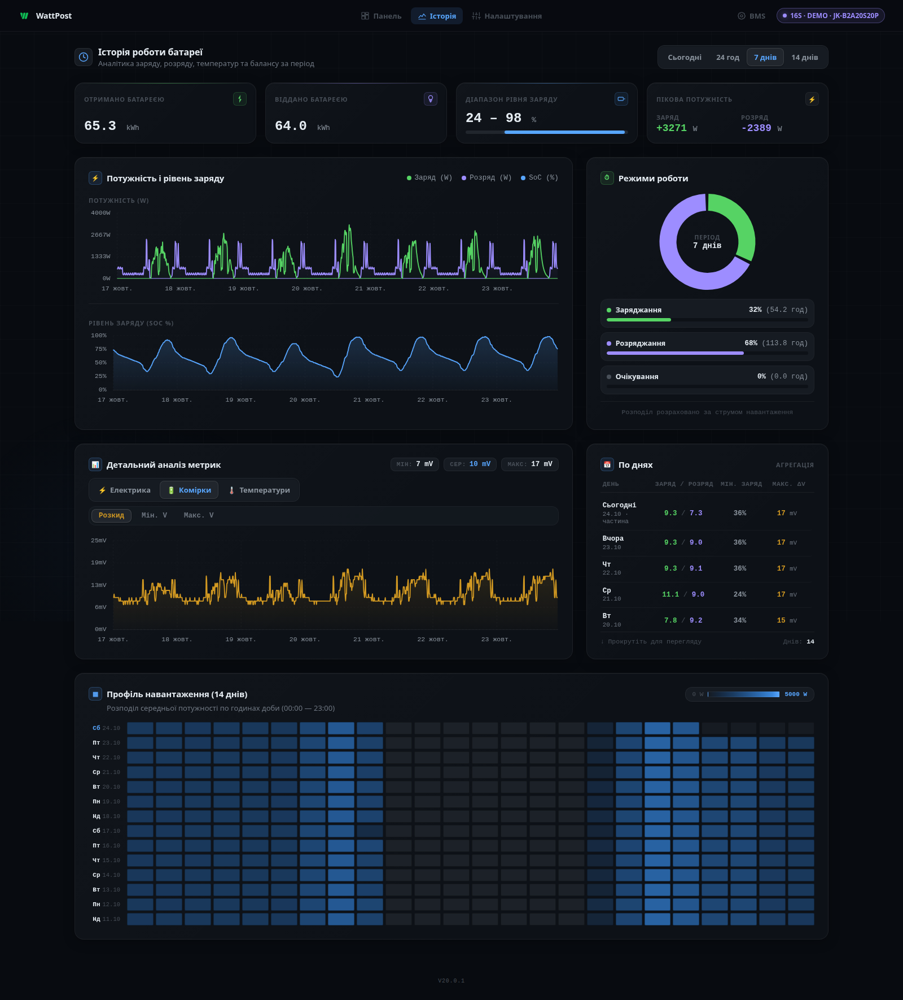
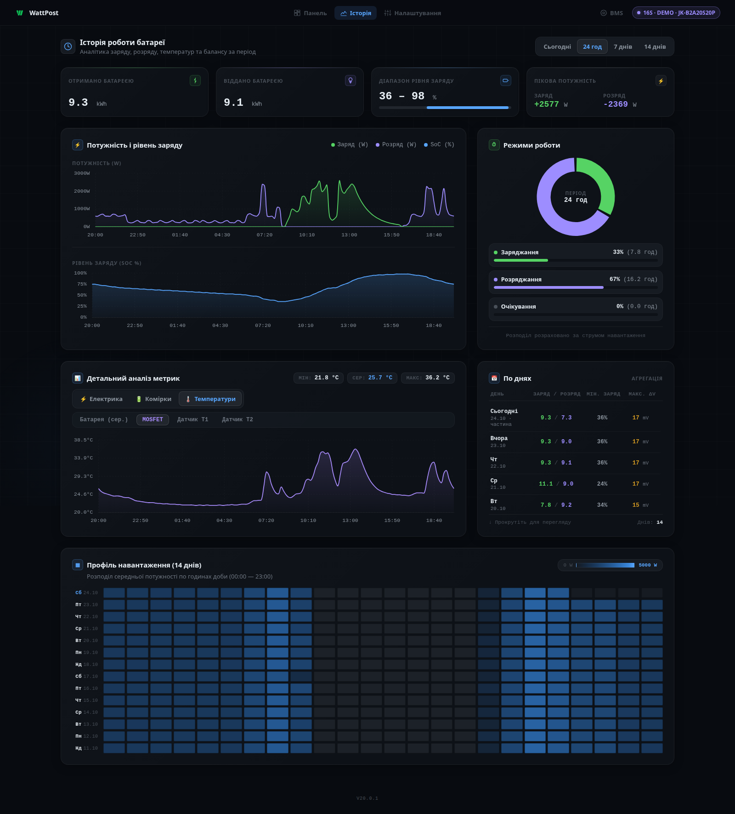
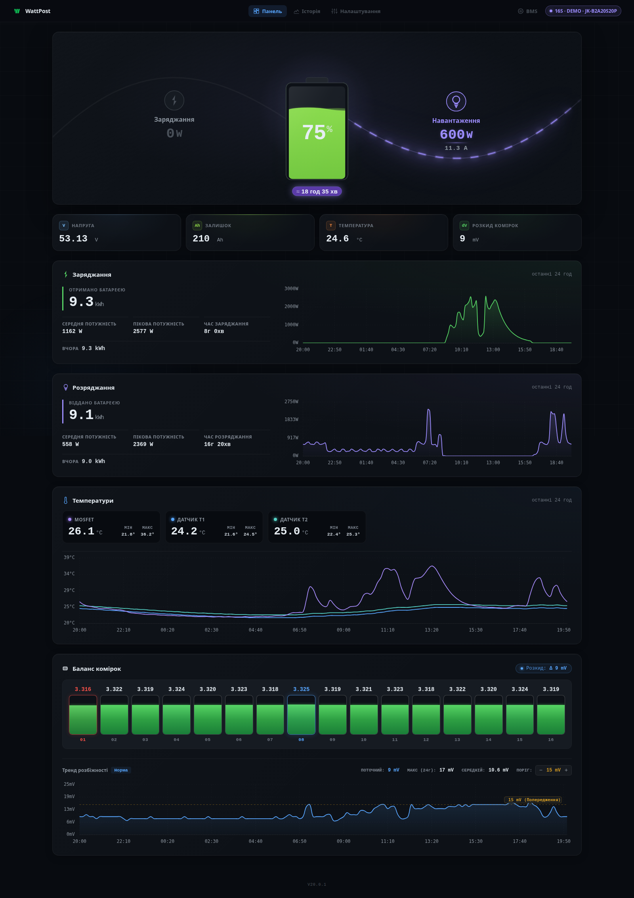
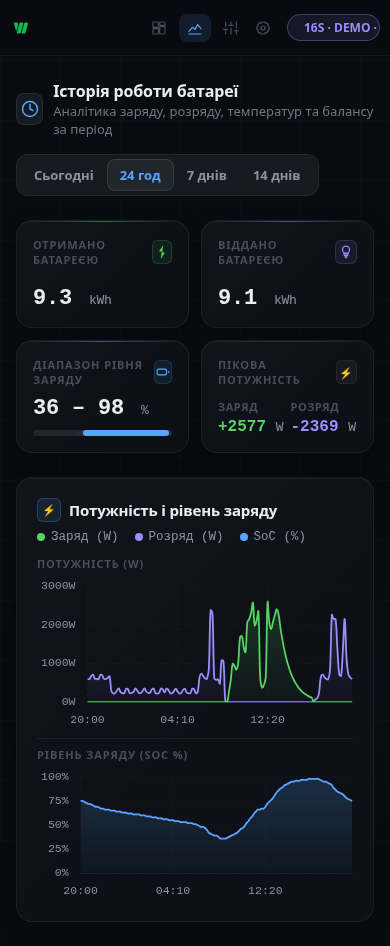

# Інтерфейс WattPost

[← Огляд проєкту](../README.md) · **Українська** · [English](INTERFACE.en.md)

Це справжній локальний вебінтерфейс WattPost V20.0.1. Усі показники та ідентифікатори в оновлених знімках вигадані; назва пристрою містить `DEMO`. Дані моделюють роботу 16S LiFePO4, 280 А·год, а не описують конкретну встановлену батарею. Дизайн і код інтерфейсу для знімків не змінювалися.

## History: повна доба

Інтервал — від 20:00 23 жовтня до 20:00 24 жовтня 2026 року за київським часом. 145 точок охоплюють 144 десятихвилинні проміжки. За ніч батарея поступово розряджається; ранкові ввімкнення приладів дають короткі піки. Вдень заряд змінюється разом із змодельованою сонячною генерацією та сповільнюється поблизу верхньої межі заряду. Увечері навантаження знову живиться від батареї.

За цю добу інтерфейс розраховує приблизно 9,3 кВт·год отриманої та 9,1 кВт·год відданої енергії. Рівень заряду змінюється від 36% до 98%. Нижній графік показує напругу: під навантаженням вона просідає, під час заряду зростає. Добова таблиця та теплова карта використовують і старіші записи, тому не обмежуються вибраними 24 годинами.

Історія зберігає усереднені значення, тож коротші за 10 хвилин піки можуть бути згладжені. Кольори, масштаби, лінії та підсумки намалював сам WattPost.

## History: тиждень і комірки

1009 точок показують сім діб. Потужність сонячної генерації та хмарність відрізняються за днями, тому глибина циклів і денні максимуми заряду неоднакові. У детальному аналізі вибрано розбіг напруг комірок, а не повторно потужність. Погодинна карта внизу допомагає порівняти ранкове й вечірнє навантаження за 14 днів; останній день ще не завершено.

## History: температурна реакція

Той самий добовий сценарій, але з вибраною температурою силових ключів MOSFET. Їхня температура реагує на підвищений струм швидше, ніж датчики батареї. Нагрівання та охолодження мають затримку; температура не копіює графік потужності.

## Dashboard

Знімок відповідає кінцю тієї ж історії: 75% заряду, близько 600 Вт навантаження та 210 А·год залишкової ємності. Напруга батареї дорівнює сумі напруг комірок, а потужність обчислюється з напруги й струму.

## BMS Settings

Усі 53 параметри заповнено явно заданими демонстраційними значеннями. Назва й серійний номер позначають приклад; це не дані чи конфігурація реального пристрою. Параметри наведено для показу екрана, а не як рекомендацію з налаштування акумулятора. Інтерфейс дозволяє переглядати та шукати параметри; змінювати їх тут не можна.

## На телефоні

<table>
  <tr><th>Dashboard</th><th>History за добу</th></tr>
  <tr>
    <td valign="top"></td>
    <td valign="top"></td>
  </tr>
</table>

Обидва знімки зроблено з шириною вікна 390 пікселів і тією самою телеметрією, що й на комп’ютері. Показано верхні частини сторінок; далі вони прокручуються до решти графіків і таблиць.

## Перше налаштування

Початковий екран майстра з попередньої документації збережено. Послідовність підключення описана в [інструкції встановлення](INSTALLATION.md).

[Як відтворити демонстрацію та перевірити дані →](demo/README.md)
